# 532 碳降 · 碳水渐降减脂

把「532 碳水渐降减脂法」做成一个能天天用的手机网页应用：**先算一次热量 → 定每周目标 → 之后只调碳水**。

纯静态、零依赖、无后端。数据只存在你自己的浏览器里。

**线上地址：<https://fishmale.github.io/532-carb-cut/>**（手机浏览器打开后「添加到主屏幕」即可当 App 用）

---

## 它按什么规则算

| 规则 | 应用里的落地 |
| --- | --- |
| 初始热量 = 基础代谢 + 训练消耗 | Mifflin-St Jeor 算 BMR；训练消耗 = 体重(kg) × 5 / 8 / 10（新手或女生 / 普通爱好者 / 高强度） |
| 首周按总消耗吃，不刻意造缺口 | 第 1 周的目标热量就是总消耗，`532` 页有「首周按此吃」标记 |
| 5 : 3 : 2 营养素 | 碳水 50%、蛋白 30%、脂肪 20%，按每克 4/4/9 kcal 换算成克 |
| 每月减 3% 体重 | 默认 3%（可在「方案 → 高级设置」改 2%–4%），拆成每周目标，例如 90 kg → 0.675 kg/周 |
| 只看每周第 7 天空腹体重 | 每天可称可记，但只有第 7 天会触发「周结算」，其它天的数字只进曲线 |
| 达标不动，未达标等 3 天再降碳水 | 结算未达标 → 生成「待调碳」提醒，3 天后才可执行，默认 −15 g（可设 15/20/25/30） |
| 只降碳水，蛋白脂肪不动 | 每次下调只改碳水克数，蛋白/脂肪保持初始值，热量随之下降 |
| 放纵餐 7–15 天一次，放晚上，不补救 | 「放纵餐」卡片记录日期，距上次 ≥7 天时提示可安排；不做任何补偿计算 |

减脂速度、体重曲线、每周结算、碳水阶梯都从这几条规则直接推出来，不做额外的「估算」。

## 界面

| 首次设置 | 今日 | 记录 |
| --- | --- | --- |
| 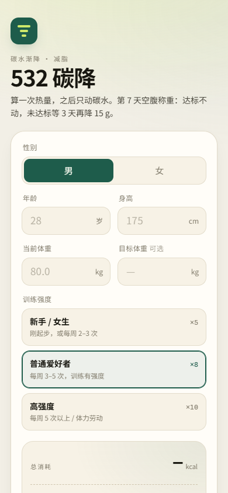 | 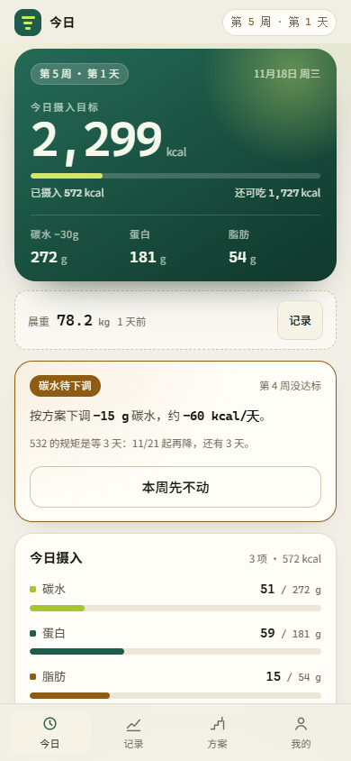 | 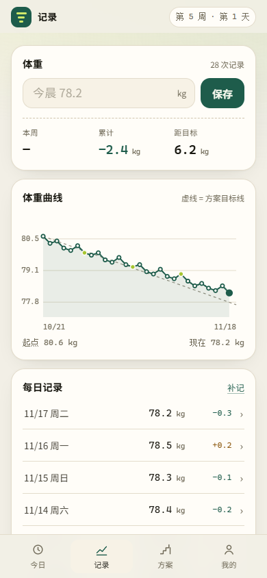 |

| 方案 | 碳水阶梯 | 我的 |
| --- | --- | --- |
| 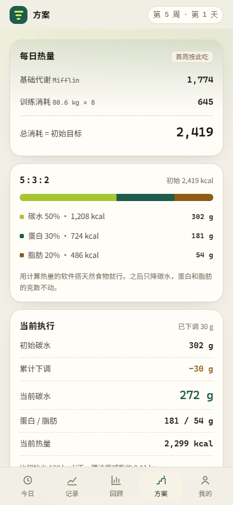 | 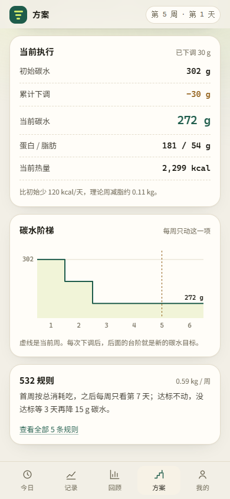 | 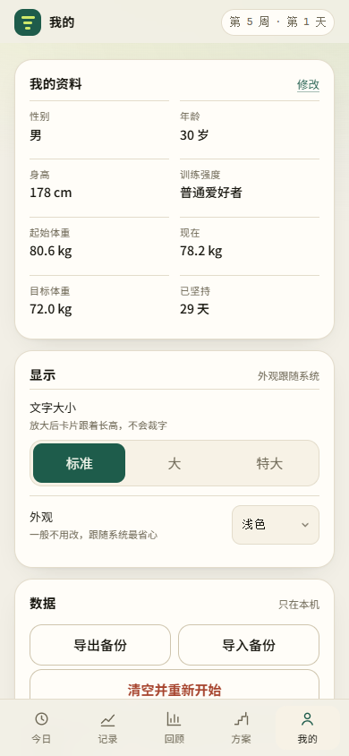 |

| 快速添加（最近常吃） | 食物选择器（分组） | 训练记录 | 深色主题 |
| --- | --- | --- | --- |
| 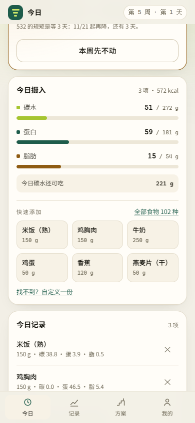 | 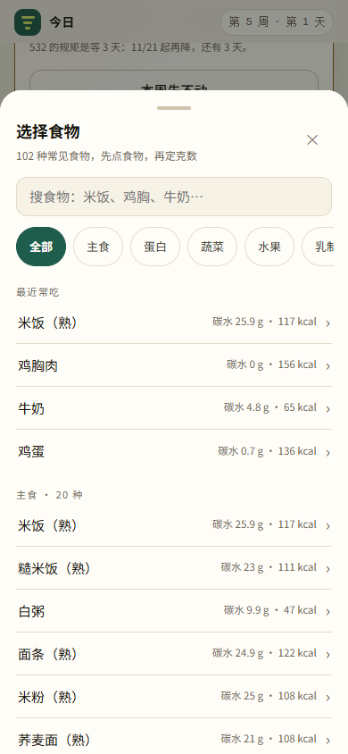 | 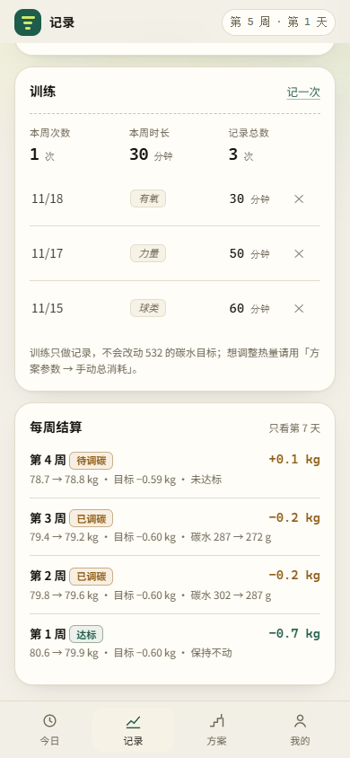 | 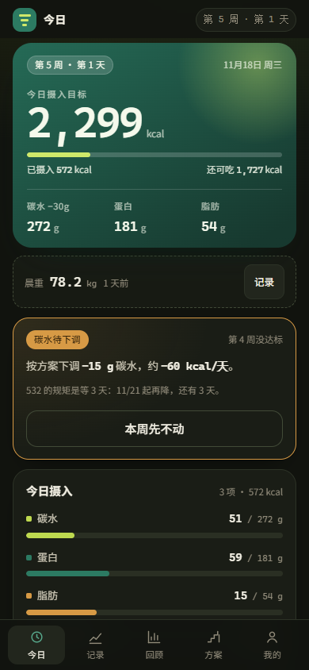 |

| 食物份量 | 记一次训练 | | |
| --- | --- | --- | --- |
| 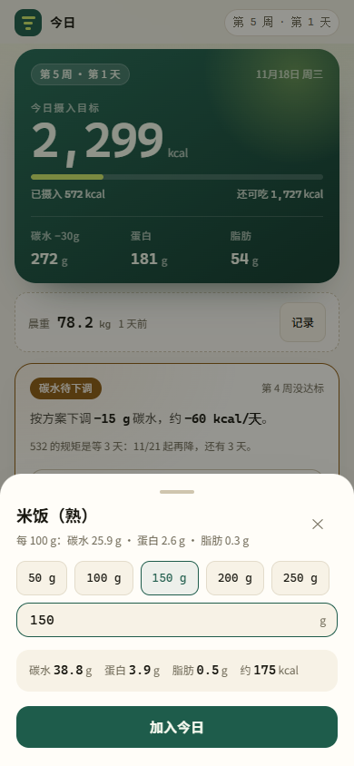 | 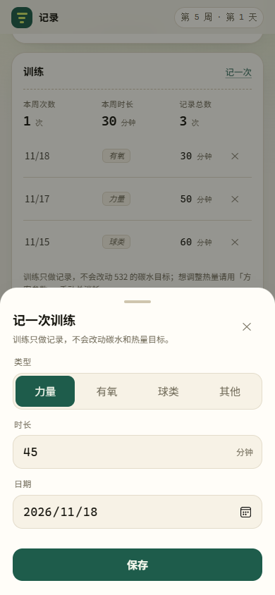 | | |

---

## 日常怎么用

**记一餐**：今日页「快速添加」默认给最近常吃的 6 个食物，点一下选份量就能加；常吃的会自己往前排。要找别的点「全部食物 102 种」，可以按名称或别名搜（如「鸡」「牛奶」「土豆」「拿铁」），也可以按主食 / 蛋白 / 蔬菜 / 水果 / 乳制品 / 坚果油脂 / 零食饮品分组翻；份量表里还有「自定义一份」直接填碳水、蛋白、脂肪。食物库是每 100 g 的营养值（常见近似值），带默认份量和搜索别名，共 102 种。

**记训练**：记录页「训练 → 记一次」可以记力量 / 有氧 / 球类 / 其他和分钟数，列表能删、删错了能撤销。训练只做记录，**不会改动 532 的碳水和热量目标**——这套方法靠饮食调碳水，练多练少不动目标；要手动改热量用「我的 → 方案参数 → 手动总消耗」。

**记体重**：每天固定时间称一次，记录页的「补记」可以选过去的日期（按日期存，一天一条，同一天再记会覆盖），点任意一行能改那一天的数字。只有每周第 7 天的记录参与周结算，其余天数只进曲线。

**看得清**：「我的 → 显示」里有文字大小三档（标准 / 大 / 特大），设置会记住；外观默认跟随系统，需要时可在同处切换。

**改参数**：周目标、每次调碳幅度、手动总消耗都在「我的 → 方案参数」里，改完立即生效。

---

## 目录结构

```
532/
├─ index.html              单页入口（首屏设置 + 主框架）
├─ manifest.webmanifest    PWA 清单
├─ sw.js                   离线缓存（发版时把 V 加 1，见下方「改完代码发版」）
├─ assets/
│  ├─ core.js              纯逻辑（UMD，无 DOM）：计算、校验、周结算、调碳
│  ├─ app.js               UI 与本地存储
│  ├─ app.css              设计系统（浅色 / 深色 / 跟随系统）
│  └─ icons/               应用图标（PWA / iOS / favicon）
├─ test/core.test.cjs      core.js 的单元测试
├─ tools/make-icons.py     重新生成图标（Pillow）
└─ screens/                验收截图
```

`core.js` 不碰 DOM、不碰 localStorage，之后移植到小程序时可以整段复用。

---

## 本地预览

浏览器直接打开 `index.html` 就能用，但 PWA 离线缓存需要 http：

```bash
cd 532
python -m http.server 8080
# 打开 http://127.0.0.1:8080/
```

或者 `npx serve 532`。

跑一遍逻辑测试：

```bash
node test/core.test.cjs
# 全部通过会输出 all good
```

---

## 部署（静态托管，任选其一）

整个 `532/` 目录就是站点根目录，**不需要构建、不需要 Node 运行时**。

**GitHub Pages**

```bash
cd 532
git init && git add . && git commit -m "532 碳降"
git branch -M main
git remote add origin https://github.com/<你>/<仓库>.git
git push -u origin main
```

仓库 Settings → Pages → Source 选 `Deploy from a branch`，分支 `main`、目录 `/ (root)`。
稍等片刻访问 `https://<你>.github.io/<仓库>/`。

**Vercel / Netlify / Cloudflare Pages**：新建项目指向该仓库，Framework 选 Other，Build command 留空，Output directory 填 `532`（或把 `532/` 作为仓库根目录）。都是免费额度。

**自己的服务器**：把目录丢进任意静态目录即可（Nginx `root` 指向它）。`sw.js` 必须以根路径可访问，否则离线功能不生效。

部署后第一次用 https 打开，点「我的 → 数据 → 安装到主屏」或浏览器菜单里的「添加到主屏幕」即可当 App 用。

**改完代码发版**：`assets/` 或 `index.html` 有改动时，把 `sw.js` 顶部的 `var V = 'N'` 加 1，并把 `index.html` 里三处 `?v=N`（app.css / core.js / app.js）改成同一个数字，否则已装到手机上的旧版本会继续读缓存。只改 README 或截图不用动版本号。

---

## 数据与隐私

- 全部数据保存在浏览器 `localStorage` 的 `carb532.state.v1`，**不上传任何服务器**，页面除自身静态资源外不发起请求。
- 换手机 / 清缓存前先到「我的 → 导出备份」存一份 JSON，新设备「导入备份」。
- 「清空并重新开始」会删除全部记录，二次确认后生效。

---

## 之后上微信小程序

这一版刻意把「算」和「显示」分开，迁移时基本不用重写规则：

1. **逻辑直接搬**：`assets/core.js` 是 UMD，任意 `require('./core.js')` 或 `import` 都能拿到 `Carb532`（`planFrom`、`currentTargets`、`settleWeek`、`applyCarbCut`、`weeklyTargetKg` 等）。
2. **存储换掉**：把 `app.js` 里读写 `localStorage` 的两个函数换成 `wx.getStorageSync` / `wx.setStorageSync`（key 保持一致，导出的旧备份还能在小程序里恢复）。
3. **视图重写**：WXML + WXSS 按现有四页（今日 / 记录 / 方案 / 我的）来搭；`weightChart()`、`carbSteps()` 目前生成的是 SVG 字符串，小程序里改用 `<canvas type="2d">` 或生态图表库重画即可，数据点算法直接照搬。
4. **资质与类目**：健康/减脂属于需要谨慎表述的类目，走小程序审核时不要写成疾病治疗或保证效果；应用内的「不是医疗建议」提示保留。
5. **成本最低的过渡方案**：先上小程序 `web-view` 指向现在这个 https 站点（需要在公众平台配置业务域名），通过审核后再逐页原生化。

---

## 说明

这是一个按公开方法自行实现的记录工具，不是医疗建议。孕期、哺乳期、未成年、有慢性病或进食障碍史的人，先问医生或注册营养师。
